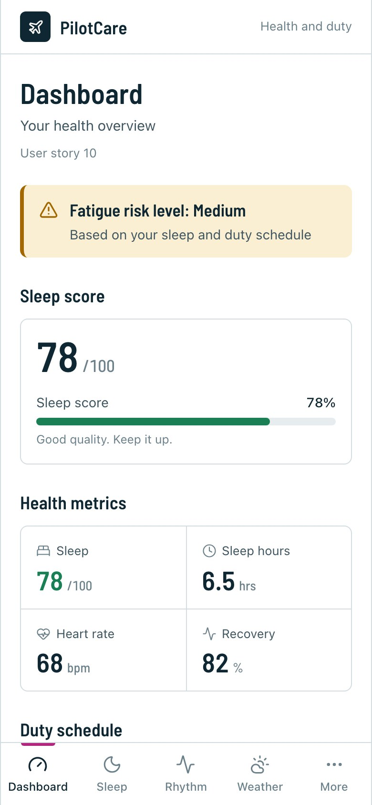
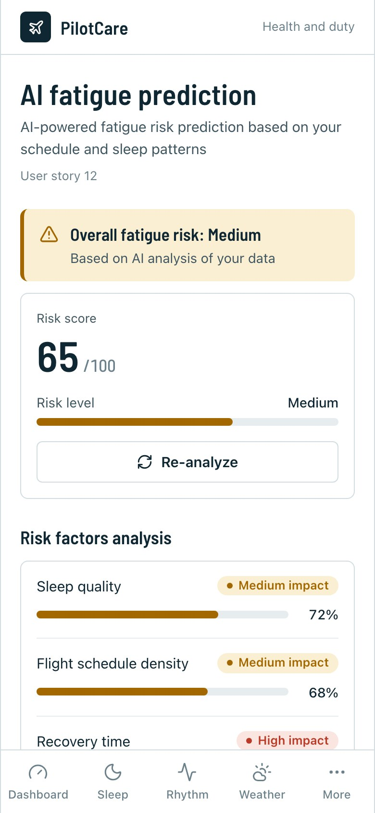
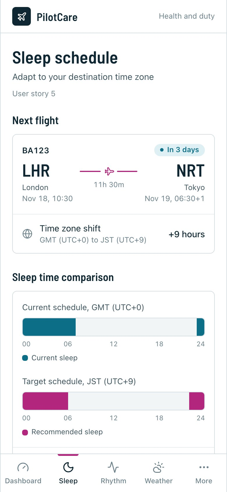
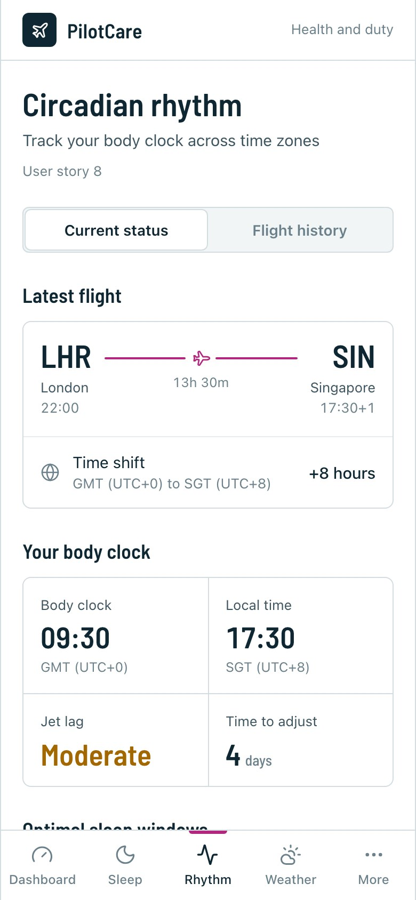

# PilotCare — an Agile (Scrum) class project

PilotCare is a health and duty companion for airline pilots: one app for sleep, fatigue, jet lag, and duty-time rules. It was the class project of **ITCS379 Practical Software Engineering** (Faculty of ICT, Mahidol University, August to November 2025), carried out in an Agile framework by a five-person Scrum team: one product owner, one Scrum master, and three developers.

I was one of the three developers. This repository is my fork of the team's repository ([AmTeamX/pilotcare](https://github.com/AmTeamX/pilotcare)). The first three commits are the team's original prototype; the later commits are my November 2026 interface revision and the write-up of the Scrum work. Every screen shows sample data.

| Dashboard | Fatigue prediction | Sleep schedule | Circadian rhythm |
|---|---|---|---|
|  |  |  |  |

## What the project practised

| Step | What the team did | Where to read it |
|---|---|---|
| 1. Vision and user | Wrote a product vision and a persona of a commercial pilot | [docs/product-vision.md](docs/product-vision.md) |
| 2. Backlog | Wrote twelve user stories with acceptance criteria, a priority, and story points (96 in total) | [docs/product-backlog.md](docs/product-backlog.md) |
| 3. Planning | Worked out the team's capacity, planned three sprints, and broke Sprint 1 into tasks | [docs/sprint-plan.md](docs/sprint-plan.md) |
| 4. Prototype | Built one clickable screen per user story | [src/app/](src/app/) |
| 5. Review | Compared estimated hours with actual hours for Sprint 1 | [docs/sprint-plan.md](docs/sprint-plan.md#sprint-1-estimate-against-actual) |

The number worth remembering: Sprint 1 was estimated at **32 hours** and took **67 hours**. It still fitted inside the 66 to 122 hours the team had planned as its capacity.

## Agile techniques used

- **Scrum roles:** product owner, Scrum master, developers.
- **Product vision and product canvas:** who the product is for and why.
- **Persona:** one invented user who stands for the real ones.
- **Epics and user stories:** "As a pilot, I want … so that …".
- **Acceptance criteria** in Given / When / Then form.
- **Backlog grooming and prioritising:** each story reworded and ranked.
- **Story points:** sizes of 1, 2, 3, 5, 13 and 20.
- **Story splitting:** the AI fatigue-prediction story was split, and its first part went into Sprint 1.
- **Release and sprint planning** from the hours the team really had.
- **Sprint backlog with tracking:** tasks with estimates, updated with actual hours.
- **Test-driven development:** two small Java exercises with JUnit 5, in [course-practice/tdd](course-practice/tdd).

## The prototype

A web app sized for a phone, built with Next.js 15, React 19, TypeScript, and Tailwind CSS 4.

```bash
npm install
npm run dev
```

Then open http://localhost:3000.

| Screen | Route | User story |
|---|---|---|
| Airline sync | `/api-sync` | 1 |
| Meditation | `/meditation` | 2 |
| Weather and health | `/weather-health` | 3 |
| Sleep tracking | `/sleep-tracking` | 4 |
| Sleep schedule | `/sleep-schedule` | 5 |
| Compliance report | `/compliance-report` | 7 |
| Circadian rhythm | `/circadian-rhythm` | 8 |
| Language settings | `/settings` | 9 |
| Dashboard | `/dashboard` | 10 |
| Device sync | `/device-sync` | 11 |
| AI fatigue prediction | `/fatigue-prediction` | 12 |

### Interface revision, November 2026

I restyled the prototype a year after the course, without changing what the screens show or do:

- No emoji. Icons are line icons from `lucide-react`.
- One shared kit in `src/components/ui.tsx`, and colour tokens in `src/app/globals.css`.
- Colour is used for status only, following a flight display: green is normal, amber is caution, red is warning, magenta is the active or recommended plan, teal is information.
- A 24-hour time strip and a route strip show sleep windows and flights.
- One behaviour fix: on the meditation screen, Stop now really stops the session timer.

## Scope

This is a class project and a prototype. The product idea and the persona are the team's own, not a commissioned product. There is no real airline system, wearable device, or AI model behind the screens: all of that is simulated with sample data.

Team documents that name or picture other team members are not included in this repository.
