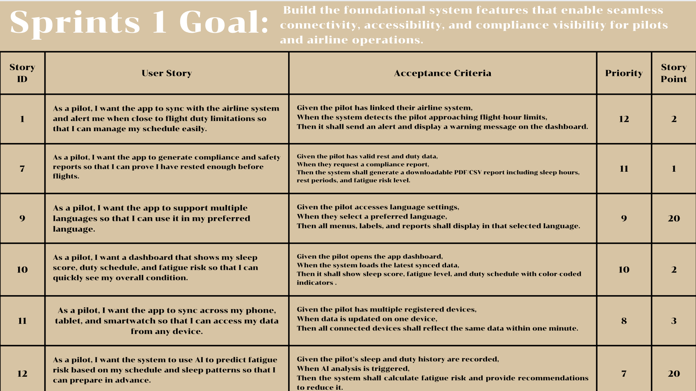

# Product backlog

Twelve user stories, 96 story points. A higher priority number means the story comes earlier. Wording is the team's, with spelling tidied.

| ID | User story | Acceptance criteria | Priority | Points |
|---|---|---|---|---|
| 1 | As a pilot, I want the app to sync with the airline system and alert me when close to flight limitations so that I can see my duty more easily. | The app must sync to the API before it can function. | 12 | 2 |
| 2 | As a pilot, I want a meditation session so that I can reduce stress. | Provide at least a 5 to 10 minute meditation session. | 5 | 2 |
| 3 | As a pilot, I want the app to show local weather and health advisories at my destination so that I can prepare for layovers. | Display the destination's weather forecast and health status. | 6 | 2 |
| 4 | As a pilot, I want the app to track my sleep and recovery using my wearable device so that I can manage fatigue and reduce the risk of unsafe flight. | Given sleep and recovery tracking, when the pilot sleeps wearing a smartwatch, then the pilot can track it and is alerted if fatigue passes a threshold. | 2 | 13 |
| 5 | As a pilot, I want the app to recommend a sleep schedule based on my next flight's time zone so that I can adapt more quickly and reduce jet lag. | Sync with the flight plan, suggest sleep and exercise, send reminders. | 3 | 5 |
| 6 | As a pilot, I want AI to predict my next best sleep window so that I can rest effectively before duty. | Given an AI-based sleep forecast, when the pilot wakes up, then the pilot can see how they slept. | 4 | 13 |
| 7 | As a pilot, I want the app to generate compliance and safety reports so that I can prove I have rested enough. | The user can select only the current and past days. The app cannot generate a report for the future. | 11 | 1 |
| 8 | As a pilot, I want the app to visualise my circadian rhythm so that I can understand how my body clock shifts with each flight. | Given a circadian chart by time zone, when the pilot flies to another country, then the pilot can see the misalignment with the duty schedule. | 1 | 13 |
| 9 | As a pilot, I want the app to support multiple languages so that I can use it in my preferred language. | Given more languages in the app, when the pilot selects a language in settings, then the app is shown in that language. | 9 | 20 |
| 10 | As a pilot, I want a simple dashboard that shows my sleep score, duty schedule, and fatigue risk so that I can see my overall condition. | Given a dashboard, when the pilot opens the app, then the pilot sees an overview of their health. | 10 | 2 |
| 11 | As a pilot, I want the app to sync across multiple devices so that I can access my data from any device. | Support iOS, Android, and smartwatch. | 8 | 3 |
| 12 | As a pilot, I want the system to use AI to predict fatigue risk based on my schedule and sleep pattern so that I can prepare in advance. | Given AI predicts fatigue, when the pilot has data from devices, then the pilot gets the fatigue result and suggestions. | 7 | 20 |

## Groomed for Sprint 1

Before the sprint, the six stories chosen for it were reworded and given acceptance criteria in Given / When / Then form.

| ID | User story | Acceptance criteria |
|---|---|---|
| 1 | As a pilot, I want the app to sync with the airline system and alert me when close to flight duty limitations so that I can manage my schedule easily. | Given the pilot has linked their airline system, When the system detects the pilot approaching flight-hour limits, Then it shall send an alert and display a warning message on the dashboard. |
| 7 | As a pilot, I want the app to generate compliance and safety reports so that I can prove I have rested enough before flights. | Given the pilot has valid rest and duty data, When they request a compliance report, Then the system shall generate a downloadable PDF/CSV report including sleep hours, rest periods, and fatigue risk level. |
| 9 | As a pilot, I want the app to support multiple languages so that I can use it in my preferred language. | Given the pilot accesses language settings, When they select a preferred language, Then all menus, labels, and reports shall display in that selected language. |
| 10 | As a pilot, I want a dashboard that shows my sleep score, duty schedule, and fatigue risk so that I can quickly see my overall condition. | Given the pilot opens the app dashboard, When the system loads the latest synced data, Then it shall show sleep score, fatigue level, and duty schedule with color-coded indicators. |
| 11 | As a pilot, I want the app to sync across my phone, tablet, and smartwatch so that I can access my data from any device. | Given the pilot has multiple registered devices, When data is updated on one device, Then all connected devices shall reflect the same data within one minute. |
| 12 | As a pilot, I want the system to use AI to predict fatigue risk based on my schedule and sleep patterns so that I can prepare in advance. | Given the pilot's sleep and duty history are recorded, When AI analysis is triggered, Then the system shall calculate fatigue risk and provide recommendations to reduce it. |
