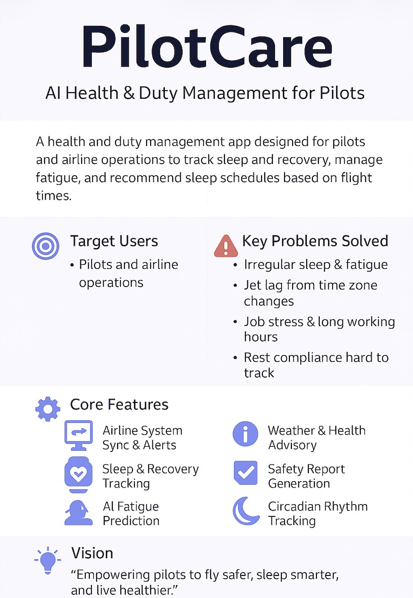

# Product vision and user

## Vision

Written on the team's product vision board, in its original wording:

> **For** pilots **who** struggle with irregular schedules, jet lag, tiredness, and stress management during flights and layovers, **PilotCare is a** watch **that** is more compatible for pilots, including a flight API that will be able to plan and manage pilot sleeping time, recover jet lag, reduce stress and stay compliant with duty-time regulation. **Unlike** separate apps like RosterBuster, Whoop, or Timeshifter that focus on only one aspect, **our product** combines scheduling, sleep tracking, jet lag assistance, and health monitoring into an all-in-one solution for pilots.

## One-page overview

## Persona

A 34-year-old commercial airline pilot, nine years in the job.

| | |
|---|---|
| **Goals** | Keep a safe and reliable flying record. Improve work-life balance despite irregular schedules. Stay up to date with aviation technology and procedures. |
| **Everyday activities** | Reviews flight plans and weather before flights. Runs pre-flight inspections and briefings. Flies with full attention on safety. Rests, exercises, and manages fatigue off duty. |
| **Frustrations** | Fatigue and irregular sleep across time zones and shifts. Time away from family. The stress of being responsible for passengers and crew. |
| **Devices** | Flight deck systems, mobile apps for flight planning and weather, a laptop for training, social media to stay in touch with family. |

## Product canvas

| | |
|---|---|
| **Name** | PilotCare |
| **Vision statement** | Provide a device with the flight schedule that can plan and manage a pilot's sleeping time, help recover from jet lag, reduce stress, and stay compliant with duty-time regulation. |
| **How the persona lives the product** | The pilot uses the app on a smartwatch, which helps manage time around flights. |
| **Epics** | Generate a flight compliance report. Time the pilot's sleep. Stay compliant with duty-time regulation. |
| **Design** | Smartwatch first. |
| **Constraint** | Some pilots do not like wearing a watch. |
